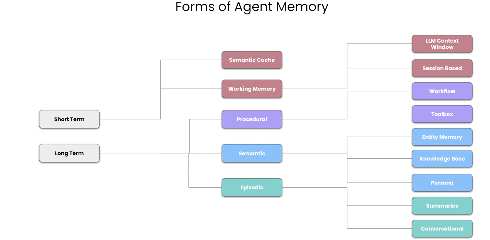

# Memory Management for AI Agents
### A 2.5-hour hands-on workshop — Facilitator Guide

> Build a memory-aware AI agent that remembers conversations, learns facts, recalls past events, and understands user patterns — using Claude, SQLite, and FAISS.

**Date:** Nov 21, 2024 · 11 AM – 1:30 PM PT · Online

---

## Schedule

| Time | Block | Format |
|------|-------|--------|
| 0:00–0:15 | Setup & welcome | Setup |
| 0:15–0:40 | Part 1 — Why agents need memory | Talk + Q&A |
| 0:40–0:50 | Demo — Context window crash | Demo |
| 0:50–1:10 | Module 1 — Conversational memory | Hands-on |
| 1:10–1:20 | ☕ Break | — |
| 1:20–1:50 | Module 2 — Long-term memory extraction + semantic cache | Hands-on |
| 1:50–2:00 | Demo — Context window recovery (compression) | Demo |
| 2:00–2:20 | Demo — Mem0 (industry standard) | Demo |
| 2:20–2:30 | Q&A + wrap up | Q&A |

---

## What We're Building

An AI support agent that remembers you across sessions.

**The agent:** "DevCore API Support" — answers developer questions about API errors, rate limits, account setup.

**The problem:** every LLM call is stateless. Without memory, the agent forgets mid-conversation and knows nothing when you open a new terminal.

**What we build today:**

| Layer | What it does | Storage |
|-------|-------------|---------|
| Conversational memory | Stores every turn — agent remembers within and across sessions | SQLite |
| Long-term extraction | LLM reads each turn, extracts facts / events / patterns, saves them | SQLite + FAISS |
| Semantic cache | Exact same question → instant answer, no LLM call | SQLite + FAISS |

**Why FAISS?** Facts and episodic memories are exact rows in SQLite — fast to look up by user ID. Patterns and understanding are stored in FAISS, a vector store from Meta — it finds semantically similar memories even when the words don't match exactly. "What do I usually get wrong?" retrieves "Alex makes copy-paste errors with credentials" via vector similarity, not keyword match.

**Key components of every agent in this workshop:**

- **System prompt** — tells the agent who it is, what it knows, how to behave. Sent on every API call.
- **Messages list** — the conversation so far: `[{"role": "user", ...}, {"role": "assistant", ...}]`. This is what the agent "sees".
- **Memory** — YOUR code decides what goes into the messages list. That's the whole workshop.

```python
client.messages.create(
    model="claude-haiku-4-5-20251001",
    system=SYSTEM_PROMPT,       # ← who the agent is
    messages=messages,          # ← what it remembers
    max_tokens=200,
)
```

---

## Setup (0:00–0:15)

While students run `python check_setup.py`:

> **Step 1 — Get an Anthropic API key:**
> 1. Go directly to [platform.claude.com/settings/keys](https://platform.claude.com/settings/keys)
> 2. Sign up or log in
> 3. Click **Create Key** — copy it immediately (shown only once)
> 4. Save it somewhere safe — never share it, never commit it to git
> 5. Paste it into `.env` as `ANTHROPIC_API_KEY=sk-ant-...`
>
> Free tier works for this workshop. No credit card required to start.

> **Step 2 — Create your `.env` file:**
> ```
> cp .env.example .env
> # then open .env and paste your ANTHROPIC_API_KEY
> ```

> **Step 3 — Create and activate the virtual environment:**
> ```
> cd memory-workshop
> python3 -m venv .venv          # create it (once only)
> source .venv/bin/activate      # Mac/Linux
> .venv\Scripts\activate         # Windows
> pip install -r requirements.txt
> ```
> **If you don't see `(.venv)` in your prompt — nothing will work.**

> **Step 4 — Run setup check:**
> ```
> python check_setup.py
> ```

- Ask: "Who here has built something with an LLM?"
- Ask: "Who ran into a problem where the agent forgot something?"

That's the problem we're solving today.

---

## Part 1 — Why Agents Need Memory (0:15–0:40)

### 1.1 LLMs are stateless

Every API call is completely fresh. Claude does not remember the previous call.

```
Call 1:   You type: "I am getting a 401 error while calling the GitHub API"
          messages = [{"role": "user", "content": "I am getting a 401 error while calling the GitHub API"}]
          → Claude responds

Call 2:   You type: "Still broken"
          messages = [{"role": "user", "content": "Still broken"}]
          → Claude has NO idea what "still broken" means
            It never saw Call 1
```

If you want the agent to remember — **your code must pass the history.**
The LLM does not manage this for you.

**Try it now:**
```
python demo/stateless.py
```
You type two messages. The second should only make sense if Claude remembered the first ("Still broken", "Same error", "What about that?"). Watch it ask you to start over — it never saw Call 1.

> **Audience question:**
> "Who here has built a chatbot that just passes the full conversation history every turn?
>  What happened when the conversation got long?"

---

### 1.2 What is the context window?

Every LLM has a context window — a hard limit on how much it can process in one API call, measured in **tokens** (roughly 1 token ≈ 1 word). Everything counts toward that limit:

- System prompt
- Conversation history (every turn so far)
- Tool outputs
- Retrieved documents (RAG, memory injection)

Once you hit the limit, the API throws an error. Your agent crashes.

```
client.messages.create(
    model="claude-haiku-4-5-20251001",
    messages=[...],   ← everything here counts toward the limit
)
```

**Everything counts toward the limit:**
- System prompt
- Conversation history (every turn so far)
- Tool outputs
- Retrieved documents

Claude Haiku has a **200,000 token** context window (~150,000 words). Sounds huge — but in a long-running agent with many turns, it fills faster than you expect.

**What happens when it overflows:**
```
anthropic.BadRequestError: prompt is too long:
200011 tokens > 200000 maximum
```

The API throws an error. Your agent crashes. The user loses the conversation.

That's what `demo/context_window.py` shows — we'll run it right after this section. And that's why we need memory — to decide what stays in the window and what gets stored elsewhere.

> **Audience question:**
> "If the context window is 200,000 tokens — why can't we just always pass everything?"
>
> Expected: cost (every token costs money), latency (bigger prompt = slower response), and noise (more irrelevant context = worse answers)

---

### 1.3 Short-term vs Long-term — with examples



**Short-term memory — exists only while the task is running:**

| Type | Example |
|------|---------|
| Working memory | Agent's scratchpad during task execution — plans, tool outputs, intermediate steps. Discarded when the task completes, even if the terminal is still open |
| Semantic cache | You asked "what's the rate limit?" — agent cached the answer. Ask again: instant reply, no LLM call |

> **Key design principle:**
> Working memory should NOT be the entire conversation history. It should be a curated, task-specific state the agent updates as execution progresses.
>
> Design memory around two questions:
> 1. What should the agent remember about the user and previous interactions? → **Long-term memory**
> 2. What does the agent need to remember to finish the current task? → **Working memory**

**Long-term memory — survives after the terminal closes:**

| Type | Example |
|------|---------|
| Conversational memory | "Alex told me last week they use Python SDK" — retrieved when relevant to a new session |
| Facts | "Alex is on the free plan" — remembered next session, next week |
| Episodic | "Nov 19 — Alex had a 401 caused by a trailing newline in their key" |
| Understanding | "Alex always makes copy-paste errors with credentials" — pattern learned over many sessions |

**The two-terminal test:**
- Close the terminal → short-term is gone
- Open a new terminal → long-term is still there

> **Audience question:**
> "If you close your laptop and reopen it tomorrow — what should the agent remember about you?
>  What should it forget?"

---

### 1.4 Facts vs Understanding — the most important distinction

From Google's agent memory architecture:

**Facts are exact. You look them up.**
```
"What plan is my DevCore account on?"  →  SQL query  →  "Pro"
"What did Alex buy?"     →  SQL query  →  exact rows
```

**Understanding is meaning. You recall it.**
```
"What do I know about Alex's style?"  →  vector search  →  "prefers simple, dark colors"
"What patterns does Alex have?"       →  vector search  →  "makes copy-paste errors"
```

> **Common mistake:** putting everything in the vector store.
> Vector stores return *similar* results, not *exact* results.
> If Alex asks "what tier am I on?" — the agent should not *guess from similar memories*.
> It should query the database for the exact row.

---

### 1.5 How memory is written — sync vs async

**Facts → write immediately (synchronous)**
```
User: "I just upgraded to Pro"
         ↓
Agent writes immediately: { fact: "Alex on Pro tier", timestamp: now }
         ↓
If the user asks next turn: "What plan is my DevCore account on?" → answer is there
```

**Understanding → write after enough context (asynchronous)**

```
Session 1: "Help me test CheckoutService"
           → user: "It depends on PaymentService and InventoryService — mock both and inject them"
           → agent saves nothing yet, one session is not a pattern

Session 2: "Help me test CheckoutService again"
           → extract_memories() runs → saves to FAISS:
              "CheckoutService depends on PaymentService and InventoryService — mock both and inject"

Session 3: "Help me test CheckoutService"
           → agent retrieves from FAISS — already knows the dependencies
           → responds: "I'll mock PaymentService and InventoryService and inject them into CheckoutService"
           → no need to explain the setup again
```

One session is a preference. Two sessions is a pattern. Session 3 — the agent already knows.


> **Audience question:**
> "Why is it dangerous to update understanding from a single sentence?
>  Example: user says 'maybe I'll try the Go SDK today' — should the agent remember 'user prefers Go'?"
>
> Expected: it's uncertain, temporary, one-off. If the agent saves it, next session it might suggest Go examples to someone who uses Python. Understanding should come from repeated patterns across sessions, not a single sentence.

---

## Demo — Context Window Crash (0:40–0:50)

```
python demo/context_window_crash.py
```

**Copy-paste these questions one at a time:**

```
1.  Hi, I'm getting a 401 Unauthorized error on all my API calls.
2.  I am passing the key correctly in the Authorization header as Bearer token.
3.  The key shows as active in the dashboard. I regenerated it last week.
4.  I updated the key in my local .env but not sure about the production server.
5.  I updated it on the server and restarted. Still getting 401.
6.  Fixed the newline issue. Now getting 403 Forbidden on the /data endpoint.
7.  How do I add write scope to my existing API key?
8.  Done. Now hitting 429 Too Many Requests. I'm on the free tier.
9.  My code doesn't handle 429 — it just crashes. What's the right pattern?
10. What happens if I exceed the daily request limit on the free tier?
    ← crash happens around here
```

**What to say while running:**

"Watch the bar fill up as we talk. At 75% — yellow warning.
No recovery. Just the crash.
This is what your users hit in production."

Stop after the crash. Don't show recovery yet.

> "This is the problem. Now let's build the fix."

---

## Module 1 — Conversational Memory (0:50–1:10)

### Theory (3 mins)

"You just saw the context window fill up. Without memory, every API call is fresh.
The agent forgets what you said two turns ago.
Close the terminal — it forgets everything.

We're going to fix that. We'll store every turn to disk.
When you reopen the terminal — the agent remembers."

### Build

**Step 1 — Have a conversation:**
```
python modules/01-conversational/module.py
```
Use the suggested questions. Chat with the agent. Then quit.

**Step 2 — Open Terminal 2, ask about the previous session:**
```
python modules/01-conversational/module.py
```
Ask: "What was my issue last time?" — agent has no idea. Blank slate.

> "This is the problem. Every run is fresh. Nothing persists."

**Step 3 — Create the DB and see the schema:**
```
python modules/01-conversational/setup_db.py
```
Shows the empty `turns` table — session, role, content, timestamp. No rows yet.

"This file lives on disk. It survives terminal close. This is where memory will live."

**Step 4 — Uncomment STEP 1, re-run:**
```
python modules/01-conversational/module.py
```
Have the conversation. Quit. Check the DB:
```
sqlite3 memory_workshop.db "SELECT session, role, content FROM turns;"
```
Every turn is saved — session ID, role, content.

**Step 5 — Uncomment STEP 2, re-run:**
```
python modules/01-conversational/module.py
```
Have the conversation again. Quit. Open a new terminal and run again.

```
Terminal 2 — python modules/01-conversational/module.py
  You: What was my issue last time?
  Agent: Last session you had a 401 error caused by a trailing newline  ← remembers
```

### After Module 1

> **Audience question:**
> "You're now saving every turn. What happens after 1000 turns?
>  You load all of them every time — what's wrong with that?"
>
> Expected: context fills up, slow, expensive
> → That's what Module 2 solves

---

## Module 2 — Long-term Memory Extraction + Semantic Cache (1:20–1:40)

### Theory (3 mins)

- Module 1 saves every word — that's not how humans remember
- Episodic: "Alex called Nov 15, had a 401, trailing newline, fixed" — specific event, compressed, timestamped
- Understanding: "Alex always makes copy-paste errors" — pattern across many sessions
- We'll build both: Claude reads each turn and extracts what matters
- Semantic cache: same question asked twice → return cached answer, 0 tokens, 0ms LLM latency

### Build

**Step 1 — Add two new tables to the existing DB:**
```
python modules/02-extraction/setup_db.py
```
Adds `memories` and `cache` to `memory_workshop.db` (already created in Module 1). Shows both schemas — 0 rows.

**Step 2 — Uncomment STEP 1, re-run:**
```
python modules/02-extraction/module.py
```
STEP 1 extracts **facts** and **episodic** memories — both saved to the `memories` table with `type = fact` or `type = episodic`. After each turn you will see:
```
  → saved fact → memories table: Alex uses Python SDK
  → saved episodic → memories table: 401 fixed, trailing newline in copy-pasted key
```
Quit. Check the DB:
```
sqlite3 memory_workshop.db "SELECT * FROM memories;"
```

**Step 4 — Uncomment STEP 2, re-run:**
```
python modules/02-extraction/module.py
```
Now understanding (patterns) is also extracted → saved to FAISS. After enough signal:
```
  → saved understanding: Alex makes copy-paste errors with credentials
```

**Step 5 — Uncomment STEP 3, re-run. Ask question 6, then question 7 (identical):**
```
python modules/02-extraction/module.py
```
Turn 6: LLM call → answer saved to cache

Turn 7: same question → cache hit:
```
  ⚡ Cache HIT — 0 tokens, 0ms LLM latency
  Agent: Free tier is 100 requests per minute.
```
Check the cache table:
```
sqlite3 memory_workshop.db "SELECT * FROM cache;"
```

**Step 6 — Delete the `long_term = []` line in STEP 4, quit, open a new terminal, re-run:**
```
Terminal 2 — python modules/02-extraction/module.py
```
Long-term memories load at session start:
```
  [green] Loaded 2 long-term memories for alex-chen
  [fact] Alex uses copy-paste for API keys
  [episodic] 401 fixed, trailing newline in copy-pasted key
```
The agent now has context before you say a word.

### After Module 2

> **Audience question:**
> "Claude just extracted memories from the conversation.
>  What could go wrong?
>  Should users be able to delete their memories?"
>
> - **Wrong extraction**: Alex said "maybe I'll try Go today" — agent saves "Alex uses Go". Next session it recommends Go examples to a Python developer.
> - **Stale facts**: "Alex is on free tier" saved in November. Alex upgraded in December. Agent still tells them they have 100 req/min limits.
> - **Privacy/GDPR**: Users have a legal right to see and delete their data. If you store memories and can't delete them on request — that's a compliance problem.
> - **Answer**: Yes — build `delete_memories(user_id)` from day one, not as an afterthought.

---

## Demo — Context Window Recovery (1:50–2:00)

Same conversation as the crash demo — but now every 4 turns, old turns are compressed into a summary and deleted. Context stays flat. Conversation never crashes.

```
python demo/context_window_recovery.py
```

Copy-paste the same questions as the crash demo. Watch the context bar stay flat instead of filling up. After every 4 turns, open a new terminal:
```
sqlite3 context_window_demo.db "SELECT * FROM context_turns;"
```
All old rows are gone. One summary row remains.

> "The agent didn't forget — it remembered the shape, not every word.
>  That's compression. That's what extraction makes possible."

---

## Demo 2 — Mem0 (2:00–2:20)

**Mem0** ([github.com/mem0ai/mem0](https://github.com/mem0ai/mem0), 69k stars) is an open-source memory layer for AI agents.

It does exactly what you just built — but as a library:
- LLM extracts facts, episodic events, and patterns after each turn
- Stores them in a vector DB (FAISS, Pinecone, Weaviate, etc.)
- On each new query, semantically searches for relevant memories
- Returns ranked results to inject into context

**Why it matters:** Every production agent team eventually builds this. Mem0 is the industry-standard version — battle-tested, with deduplication, conflict resolution, and cross-session memory built in.

**Two lines replace everything you built in Module 2:**

```python
# SAVE — after each turn
# Mem0 calls Claude internally, extracts facts/events/patterns, then:
#   → FAISS (vector store) — for semantic search
#   → SQLite at ~/.mem0/history.db — history + metadata (automatic)
mem0.add([
    {"role": "user", "content": question},
    {"role": "assistant", "content": answer},
], user_id="alex-chen")

# RETRIEVE — before each turn
# Mem0 embeds the question, vector similarity search in FAISS, returns top matches
memories = mem0.search(question, filters={"user_id": "alex-chen"}, limit=3)
```

### Run

**Terminal 1 — Session 1:**
```
python demo/mem0_session1.py
```
Alex reports a 401 issue. Watch memories get extracted after each turn.

**Terminal 2 (new terminal) — Session 2:**
```
python demo/mem0_session2.py
```
New process, new terminal. Mem0 loads memories from Session 1 before Alex says anything. Agent already knows about the trailing newline, the Python SDK, and more.

"Same architecture you built in Module 2. You wrote ~300 lines. Mem0 is 2 lines.
But now you understand every line inside it."

> **Audience question:**
> "Claude just extracted memories from the conversation. What could go wrong?
>  Should users be able to delete their memories?"
>
> - **Wrong extraction**: Claude extracted "Alex is on free tier" but Alex upgraded last month. The agent keeps giving wrong answers until that memory is deleted and replaced.
> - **Stale episodic**: "Alex had a 401 from a trailing newline" was true 6 months ago. If it persists forever, the agent assumes that's the issue every time Alex reports a 401. Wrong assumption, bad support.
> - **Privacy / GDPR**: Users have a legal right to see and delete their personal data. "Delete my account" must also delete all memories — if you can't do that, you have a compliance problem.
> - **The fix**: Build `delete_memories(user_id)` from day one. Add a TTL (time-to-live) on facts — expire after 90 days unless refreshed. Let users see what's stored. Mem0 has `mem0.delete()` and `mem0.get_all()` built in for exactly this.

---

## Q&A (2:20–2:30)

**Q: How is this different from just passing full conversation history?**
> Full history fills the context window. Memory retrieval passes only what's relevant — higher signal, lower token cost.

**Q: When should memory operations be synchronous vs asynchronous?**
> Sync for facts — user expects them saved immediately.
> Async for understanding — needs enough context, don't update identity from one sentence.

**Q: What database should I use in production?**
> SQLite works up to millions of rows. For scale: Postgres + pgvector, or Pinecone/Weaviate for vectors.

**Q: How does Mem0 know what type of query it is?**
> Semantic search — Mem0 embeds the query and finds the closest memories. In production you can also add keyword routing or a small LLM classifier.

**Q: Should users be able to delete their memories?**
> Yes — GDPR requires it. Build a `delete_memories(user_id)` function from day one.

**Q: What happens when extracted memory is wrong?**
> This is real. Use confidence scores. Flag low-confidence extractions for review. Don't auto-write everything.

---

## Key Takeaways

1. **LLMs are stateless** — your code manages memory, not the LLM
2. **Facts vs Understanding** — exact lookup vs semantic recall, different stores
3. **Sync vs Async writes** — facts immediately, understanding after enough context
4. **Two-terminal test** — if it survives a terminal close, it's long-term memory
5. **Extraction compresses** — you store what matters, not every word
